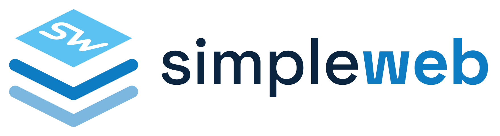

<p align="center">
  
</p>

<p align="center"><strong>A base que não decide por você.</strong></p>

<p align="center">
  Framework SaaS multiempresa em PHP, criado por <a href="https://phsa.com.br">Pedro HSA</a> · PHSA Tecnologia
</p>

<p align="center">
  
  
  
  
</p>

---

## O que é

O **Simple Web** é a fundação que uso para construir sites e sistemas SaaS. Todo projeto começava do mesmo lugar: login, organizações, empresas, usuários, permissões, planos, cobrança e financeiro. O Simple Web reúne essa base comum, amadurecida em produtos reais construídos sobre ela, e deixa a regra de negócio livre para cada produto.

Este repositório é a **versão pública de demonstração**: a base funciona de ponta a ponta (site, contratação de plano, cadastro, login e área administrativa), mas **nenhuma regra de negócio de produto está aplicada**.

> 🌐 Demonstração: **https://simpleweb.phsa.com.br** (em breve)

## O que vem pronto

| Área | Recursos |
|---|---|
| **Multiempresa** | Projeto → Organização → Empresa, com escopo de dados por organização, empresa ou hierarquia aplicado nos models |
| **Acesso** | Usuários, níveis de acesso, permissões `recurso.acao` e troca de contexto |
| **SaaS** | Planos com limites por módulo, página de contratação, cadastro, regularização e integração de pagamento (Pagar.me) |
| **Financeiro** | Contas, formas e condições de pagamento, plano de contas, centro de custo, títulos, lançamentos, transferências, fornecedores e relatórios |
| **Componentes** | Endereço, contato e arquivo polimórficos; cadastros básicos genéricos; histórico/auditoria automática em todas as entidades |
| **Conteúdo** | Central de ajuda, templates de e-mail, página pública por empresa (`/{slug}`) e PWA |
| **Ambientes** | BCC (banco compartilhado) e BCD (banco dedicado por organização) com o mesmo código |

## Arquitetura

```text
Requisição → .htaccess → index.php
   → .env, validação, conexão PDO, boot (projeto, usuário, contexto, plano)
   → SimpleRouter → Controller → Model / Service → View (League Plates) ou JSON
```

```text
source/
  Core/          núcleo: SimpleConnect, SimpleController, SimpleModel, SimpleResponse,
                 SimpleRouter, SimpleSession, SimpleUpload, SimpleValidator, SimpleWeb
  Controller/    sistema/ (área administrativa) e site/ (público, contratação, webhooks)
  Model/         dados, escopo e segurança final
  Service/       processos entre módulos
  Web/           views, templates, CSS e JavaScript
framework/       bibliotecas front-end mantidas localmente
project/
  docs/          descrição técnica
  identidade/    marca (SVG, PNG e manual)
  script/        estrutura e base inicial do banco
```

Um CRUD completo segue sempre o mesmo desenho:

```php
$router->group('fornecedor', 'sistema', 'FornecedorController', function ($router) {
  $router->get('form', 'form', 'formNovo');
  $router->get('form/{id}', 'form');
  $router->get('list');
  $router->post('pesquisarFornecedor');
  $router->post('salvarFornecedor');
  $router->post('alterarStatusFornecedor');
}, 'fornecedor.');
```

```php
class FornecedorModel extends SimpleModel
{
  protected string $tabela = 'fornecedor';        // físico: DB_PREFIX_fornecedor
  protected string $prefixo = 'for';
  protected string $escopoContexto = 'empresa';   // filtra pela organização e empresa ativas
  protected bool $usarLog = true;                 // histórico automático
}
```

## Instalação local

Requisitos: PHP 8+, MySQL/MariaDB, Apache com `mod_rewrite` e Composer.

```bash
git clone https://github.com/pedrohsa92/simple-web-framework.git
cd simple-web-framework
composer install
copy .env.example .env      # ajuste banco e URL local
```

Crie o banco executando `project/script/rodar_scripts.bat` (Windows/WAMP) ou importe, nesta ordem, os scripts `create 01` e `insert 01` de `project/script/`.

Acesso de demonstração: usuário **`admin`**, senha **`simpleweb`**.

## Documentação

- [`AGENTS.md`](AGENTS.md): padrões de código e de interface (listagem, cadastro, permissões, histórico, scripts). Também serve de instrução para assistentes de IA.
- [`project/docs/01 - DESCRIÇÃO TÉCNICA DO PROJETO.md`](project/docs/): arquitetura, contexto, escopos, planos, BCC/BCD.
- [`project/identidade/`](project/identidade/): marca e manual de identidade visual.

## Princípios

- Simplicidade antes de abstração: o código mostra o que acontece.
- Autorização sempre no servidor; o model é a última barreira.
- A infraestrutura decide o ambiente; o módulo executa o domínio.
- Arquivos fora do banco.
- A base resolve o que é comum. O produto decide o resto.

---

### English

**Simple Web** is a multi-tenant SaaS framework in PHP 8 built by Pedro HSA (PHSA Tecnologia). It ships the foundation every SaaS needs (organizations and companies, users and permissions, plans with sign-up and payment, basic finance, audit history, public company pages) and deliberately leaves business rules to each product. This repository is a public, working demo of that base. Licensed under MIT.

## Autor

**Pedro HSA** · [PHSA Tecnologia](https://phsa.com.br) · contato@phsa.com.br

Licença [MIT](LICENSE): use à vontade, mantendo os créditos.
